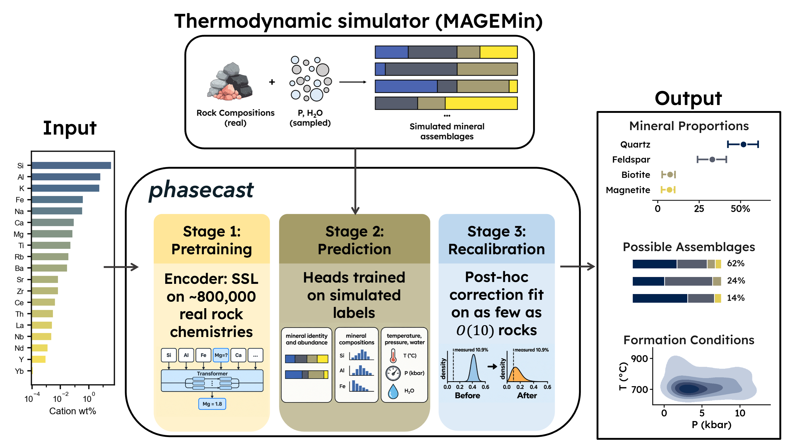

# phasecast: probabilistic mineralogy from whole-rock geochemistry

[](https://github.com/matthew-j-liu/phasecast/actions/workflows/tests.yml)
[](https://arxiv.org/abs/2610.36429)



The model takes the whole-rock chemistry of a rock and predicts mineral identity, 
mineral abundance, and formation conditions. Each prediction is a probability
distribution, as one chemistry can map to a multitude of possible mineral assemblages. 
This repository holds the code for *Simulated petrological labels
enable probabilistic mineralogy prediction from whole-rock geochemistry*, a paper
at the NeurIPS 2026 Sim2Science workshop. To reproduce the results of the paper,
use the [`submission`](https://github.com/matthew-j-liu/phasecast/tree/submission)
branch, which also holds the figure scripts and corpus excerpt described below. The `main` branch
contains later research, so its results differ from those in the paper. Tags
mark earlier versions of the code.

## Overview

Modal mineralogy, the mineral identities and abundances in rocks, guides
geological studies and industrial resource extraction. While measuring modal
mineralogy is time-intensive, whole-rock chemical measurements furnish
elemental concentrations at higher throughput. Predicting mineralogy from
elemental data, however, poses a one-to-many inverse problem, and labeled
mineralogical datasets are too sparse to train on at scale. We address both
challenges by simulating petrological labels that express multiple formation
conditions per composition and at a scale unattainable by measurements.

The model is comprised of three stages (center panel). Pretraining teaches a
transformer encoder the structure of rock chemistry by recovering elements
hidden from roughly 788,000 measured whole-rock compositions. Prediction uses
three heads on the encoding to predict which minerals are present and in what
proportions, the oxide composition of each mineral, and the temperature,
pressure and water content of the melt. The heads learn from labels generated by
the thermodynamic simulator MAGEMin, which crystallizes real rock compositions
under sampled pressure and water content (top panel). Optional post-hoc 
recalibration fits a small correction on measured rocks to align the predictions with real
mineralogy. Zero-shot on 640 volcanic rocks, the model discriminates the
presence of most mineral categories and predicts which rocks are richer in
each mineral, but the predicted abundances are systematically offset from
measured values. Recalibration fit on as few as 25 labeled rocks recovers 76
percent of the likelihood improvement from fitting on the full 368-rock
fitting set. Meanwhile, abundance error decreases from 11.0% zero-shot to
9.5% with the full fitting set.

## Installation

```bash
conda env create -f environment.yml
conda activate mineral
pip install -e .
pytest tests/        # optional smoke check
```

Only stage 3 below (label generation) additionally needs Julia with MAGEMin.
Install Julia 1.12 (for example through juliaup), then instantiate the pinned
environment in `magemin/`:

```bash
julia --project=magemin -e 'using Pkg; Pkg.instantiate()'
```

## Pipeline

The two production checkpoints are tracked, so stages 2 to 4 can be skipped:
stage 5 and the tutorial run against them directly.

**1. Tokenize whole-rock chemistry** *(in-package)*. The model reads one
composition as a set of element tokens (element identity plus amount) with an
optional iron-redox row; temperature, pressure, and water content are never
inputs. Tokenizer: `src/cnmineral/data/tokens.py`. The pretraining
compilation (Gard et al. 2019) is a public download.

**2. Pretrain the encoder** *(trained encoder tracked)*. Masked-element
self-supervision over roughly 788,000 compositions spanning all rock types.

```bash
python scripts/training/pretrain.py --config configs/pretrain/pretrain_allrock_redox.yaml
```

**3. Generate simulated labels** *(needs Julia and MAGEMin)*. Each label pairs
one measured composition with the mineral assemblage `MAGEMin` computes for
it. Sampling several pressure and water conditions per composition lets the
labels express multiple formation conditions for one rock.

```bash
python scripts/build/generate_mineralogy_corpus.py --bulks <bulk csvs> --out data/corpus --draws 24
```

**4. Train the heads** *(trained heads tracked)*. Three heads predict
distributions over mineral abundances, per-phase compositions, and formation
conditions from the frozen encoder's representation.

```bash
python scripts/training/joint_heads.py --config configs/heads/joint_heads.yaml
```

**5. Evaluate on measured rocks**. Evaluates the model on the 640-rock
volcanic benchmark, zero-shot and with the recalibration layer fit on the
fitting split. The third command measures how the recalibration layer improves
with fitting-set size; on `main` it runs on the rebuilt benchmark split, so
its numbers differ from the paper's.

```bash
python scripts/eval/real_rock.py --checkpoint checkpoints/joint_heads_allrock_tuned_seed0/heads_best.pt
python scripts/eval/real_rock.py --checkpoint checkpoints/joint_heads_allrock_tuned_seed0/heads_best.pt --fit-recalibrator
python explorations/real_rock_fewshot/run_curve.py --checkpoint checkpoints/joint_heads_allrock_tuned_seed0/heads_best.pt --select-wd
```

## Running the model on your own rocks

`docs/tutorial/` takes a table of compositions to a per-rock posterior over
mineralogy and formation conditions, zero-shot and recalibrated, with the
figure an application would draw. Inference needs no Julia or MAGEMin.

## Reproducing the paper

The [`submission`](https://github.com/matthew-j-liu/phasecast/tree/submission)
branch and the `sim2sci-camera-ready` release hold the paper state:
`figures/src/` (one `fig_*.py` per figure, the `extract_*.py` scripts that
rebuild their inputs, and the `fit_*.py` scripts for the few-shot
experiment), `figures/data/` (the frozen figure inputs), and
`data/corpus_excerpt.csv` (one composition's sampled crystallization runs and
the resulting assemblages).

## Checkpoints and data

| path | contents | size |
|---|---|---|
| `checkpoints/pretrain_allrock_redox_seed0/epoch_best.pt` | the pretrained encoder: a plain `torch.save` dict (encoder and optimizer state, training config, loss history) -- load with `cnmineral.training.Checkpoint.load` | 44 MB |
| `checkpoints/joint_heads_allrock_tuned_seed0/heads_best.pt` | the three supervised heads (mineral abundances, phase compositions, formation conditions): state dicts plus their head, loss, and label configs -- load with `JointHeadCheckpoint.load` | 7 MB |
| `data/real_mineralogy/samples.csv` | benchmark chemistry and metadata: 730 volcanic samples with major oxides, 13 trace elements, and petrographic notes, keyed by source and sample id | 240 KB |
| `data/real_mineralogy/modes.csv` | the same samples' measured mineral abundances, one row per sample-phase pair, carrying each source's own phase name and its mapping into the model's vocabulary | 240 KB |

The benchmark evaluation joins the two CSVs and evaluates the 640
least-altered rocks that quantify at least one mineral abundance (724 rocks
carry both chemistry and modes). The train, validation and test splits ship
inside the package (`src/cnmineral/data/`).

Not included: the full simulated corpus (3.5 GB of parquet, regenerable end
to end from the public compilation via stage 3) and transient run outputs.
The full corpus will be hosted on MPContribs; the link will appear here once
the upload is live.

## Repository layout

- `src/cnmineral/`: the package (data and tokenization, models, losses,
  training, evaluation).
- `scripts/`: command-line entry points (`build/`, `training/`, `eval/`,
  `view/`), most driven by a YAML file in `configs/`.
- `magemin/`: the pinned Julia environment and the MAGEMin driver.
- `explorations/`: one directory per research question, with its code,
  findings and committed results.
- `results/`: headline figures and numbers per model version.
- `docs/`: the encoder (`encoder.md`), the heads (`heads.md`), architecture
  decisions (`decisions.md`) and the dated research log (`journal.md`).

## License and attribution

The code is MIT (`LICENSE`). Material the repository redistributes or builds
on:

- Element embeddings (`src/cnmineral/data/element_properties/mat2vec.csv`):
  the mat2vec embeddings of Tshitoyan et al. (2019), MIT, as packaged by
  CrabNet (Wang et al. 2021, MIT), whose composition tokenization the encoder
  follows.
- Pretraining compilation: Gard, Hasterok and Halpin (2019), CC BY 4.0. The
  full table is a public download and is not redistributed here;
  `tests/fixtures/complete_subset.parquet` is a 2,000-row subset of it.
- Benchmark chemistry and mineralogy (`data/real_mineralogy/`): USGS
  publications by du Bray et al. (Data Series 764, 942 and 1099,
  Professional Paper 1793) and Pallister et al. (Pinatubo; Mount St. Helens,
  Professional Paper 1750), US Government works in the public domain.
- Simulated labels: generated with MAGEMin (Riel et al. 2022, GPL-3.0), which
  `magemin/run_magemin.jl` runs as a separate Julia program. MAGEMin is not
  redistributed and its outputs carry no license obligation.
- Feldspar naming (`src/cnmineral/data/feldspar_rule.py`): a reimplementation
  of the Deer, Howie and Zussman two-feldspar boundaries as adapted by
  Thermobar (Wieser et al. 2022, MIT) and mineralML (Shi et al., GPL-3.0);
  the boundary values are theirs, the code is not.
